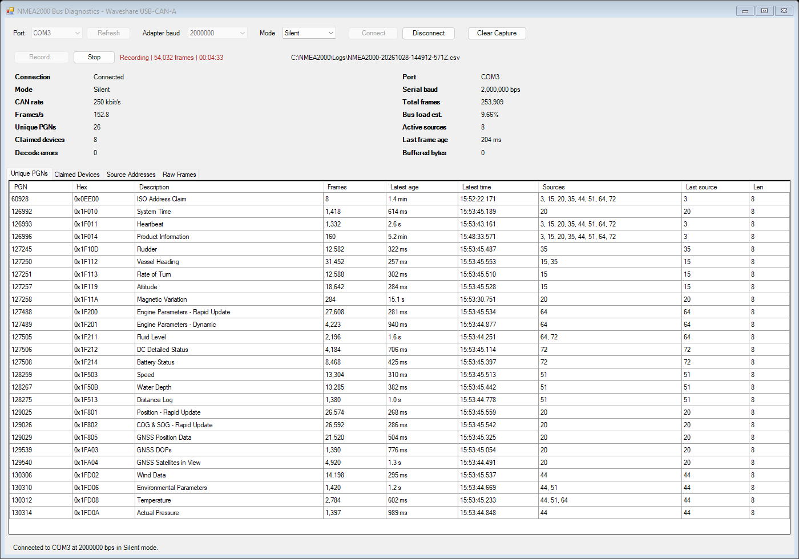
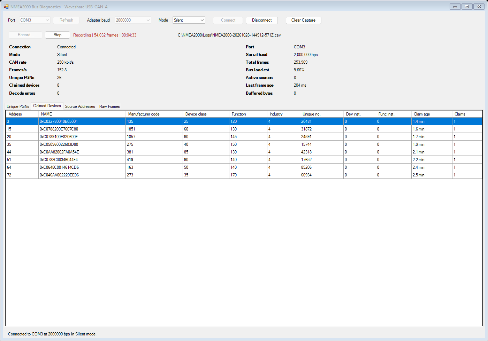
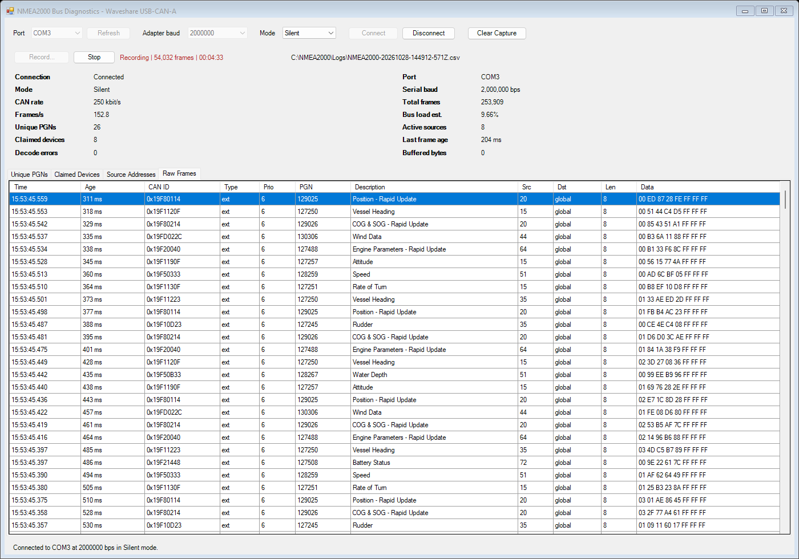

# NMEA2000 Diagnostics

A portable Windows desktop viewer for observing a NMEA2000 bus through a
**Waveshare USB-CAN-A** adapter. It continuously displays received PGNs, their
latest ages, source-address activity, address claims, and recent CAN frames.

**[Download the portable EXE](https://github.com/Cederb/NMEA2000-Diagnostic-App/releases/latest/download/NMEA2000Diagnostics.exe)**
| [All releases](https://github.com/Cederb/NMEA2000-Diagnostic-App/releases)

The application opens directly as a Windows desktop window. It needs no
installer, companion scripts, or configuration files. The Waveshare USB driver
must be installed separately.



<details>
<summary>Device list and raw traffic</summary>





</details>

## Contents

- [Features](#features)
- [Requirements](#requirements)
- [Quick start](#quick-start)
- [Connection controls and modes](#connection-controls-and-modes)
- [Recording traffic](#recording-traffic)
- [Status indicators](#status-indicators)
- [Diagnostic views](#diagnostic-views)
- [Device discovery and NAME values](#device-discovery-and-name-values)
- [Adapter protocol](#adapter-protocol)
- [Current limitations](#current-limitations)
- [Run from source](#run-from-source)
- [Build the portable EXE](#build-the-portable-exe)
- [Verification](#verification)
- [Troubleshooting](#troubleshooting)
- [Project layout](#project-layout)
- [References](#references)

## Features

- Connect to and disconnect from a selected Windows COM port.
- Select **Silent** or **Normal** CAN mode, including while connected.
- Configure the adapter for NMEA2000 at **250 kbit/s**, using extended CAN IDs.
- Monitor total frames, receive rate, estimated bus load, and latest-frame age.
- List every unique PGN received, its frame count, sources, and latest age.
- Recognize common PGNs and show descriptions when available.
- List devices observed sending ISO Address Claim, PGN **60928**.
- Display each claimed address, its 64-bit protocol NAME, and numeric NAME fields.
- Review source-address activity and the newest **500** raw CAN frames.
- Clear the captured data while leaving the connection open.
- Record incoming traffic to a timestamped UTF-8 CSV file for later analysis.
- Run as a single portable EXE or directly from the PowerShell source.

## Requirements

| Component | Requirement |
| --- | --- |
| Operating system | Windows 10 or Windows 11 with Windows PowerShell 5.1 and .NET Framework available |
| Adapter | Waveshare **USB-CAN-A**, exposed as a Windows COM port |
| USB driver | The CH341SER driver specified by Waveshare for this adapter |
| Network | An operating NMEA2000 bus with suitable CAN wiring and termination |
| Additional runtime downloads | No PowerShell 7, .NET SDK, Python, or Node.js installation is needed |

The app implements the USB-CAN-A serial protocol specifically. Compatibility
with USB-CAN-B, USB-CAN-FD, SLCAN adapters, and other USB-to-CAN products is not
provided by this version.

The EXE is a compiled .NET Framework host with the application embedded as a
resource. It uses Windows' PowerShell engine in-process and opens without a
console window. The binary is not code-signed. It does not require administrator
privileges to run; driver installation may require them.

## Quick start

1. Install the adapter's USB serial driver using the
   [Waveshare USB-CAN-A instructions](https://www.waveshare.com/wiki/USB-CAN-A).
2. Connect the adapter to the PC and identify its COM port under
   **Device Manager > Ports (COM & LPT)**.
3. Connect the adapter to the NMEA2000 network according to the adapter and
   network wiring documentation. Match CAN-H and CAN-L and preserve the
   network's intended termination.
4. Download `NMEA2000Diagnostics.exe` from the latest release and double-click it.
5. Choose the adapter's **Port**. Use **Refresh** if it was connected after
   opening the app.
6. Leave **Adapter baud** at `2000000` unless the adapter was previously set to
   a different serial rate.
7. Select **Silent**, the default mode for passive observation, and click
   **Connect**.
8. Watch **Total frames** increase and inspect the diagnostic tabs.

The serial baud rate is the PC-to-adapter speed; it is separate from the
NMEA2000 CAN rate. The app fixes the CAN rate at 250 kbit/s.

## Connection controls and modes

| Control | Behavior |
| --- | --- |
| Port | Selects the COM port to open |
| Refresh | Refreshes the list of Windows COM ports while disconnected |
| Adapter baud | Selects the PC-side serial rate; default `2000000` |
| Mode | Selects Silent or Normal and sends the corresponding configuration while connected |
| Connect | Opens the serial port and writes the adapter configuration |
| Disconnect | Stops and saves any recording, closes the serial connection, and retains the live capture data |
| Clear Capture | Clears the live counters and tables; an ongoing recording continues |
| Record... | Opens a save-file picker and starts recording new incoming frames |
| Stop | Stops recording and flushes queued rows to disk while live capture continues |

**Silent** requests listen-only CAN operation. **Normal** requests normal CAN
controller participation, including acknowledgements. The app does not send
NMEA2000 application messages in either mode: it does not claim its own address,
request device information, or provide a transmit console.

Changing **Adapter baud** does not reprogram the adapter's stored serial baud
rate. The selected value must match its existing configuration. The available
values are `2000000`, `1228800`, `115200`, `38400`, `19200`, and `9600`.

**Connected** means the COM port opened and the configuration write completed.
The app does not read back configuration or confirm that the adapter applied
the selected mode. Receiving valid frames is a separate indication that the
data path is working.

Disconnect closes the PC's serial handle; it does not send a CAN stop or reset
command. Do not assume the adapter's CAN controller has stopped participating
merely because the UI says Disconnected.

Clearing a live capture does not pause reception. New traffic can repopulate
the views immediately. Disconnect first to leave the cleared views empty.
Closing and reopening the app starts a new, empty capture.

## Recording traffic

Recording is available in source/portable builds with file version **1.1.0.0**
or later. It works with either Silent or Normal mode and adds no CAN messages
to the bus.

1. Connect to the adapter and confirm that frames are arriving.
2. Click **Record...** and select a CSV file. The suggested filename includes
   the current UTC date/time, for example `NMEA2000-20261028-120000-123Z.csv`.
3. The recording bar shows the state, frame count, elapsed duration, and path.
   Hover over a shortened path to see it in full.
4. Click **Stop** to finish the file while continuing to monitor the bus.

Recording begins after the file is selected. It records newly received frames,
not the history already displayed in the app. It retains all successfully
logged frames, independently of the live raw view's 500-frame limit.

**Clear Capture** does not reset the recording's elapsed time or count, erase
the file, or discard an in-progress receive packet while recording. Changing
CAN mode is reflected in subsequent log rows. Disconnecting, a serial-read
failure, or closing the window stops recording and flushes pending rows. The
window waits for the recording to finish before closing.

The file picker asks before overwriting an existing file. Stopping and starting
again creates a new recording session; files are not appended automatically.
Recording an idle bus produces a valid header-only CSV.

### CSV format

The file uses UTF-8 without a BOM, comma delimiters, a header row, and quoted
CSV fields. There is one row per received CAN frame in arrival order.
Numbers use an invariant format regardless of the Windows regional settings.

| Column | Meaning |
| --- | --- |
| `timestamp_utc` | PC receipt/parse time in ISO 8601 UTC, including the date and a `Z` suffix |
| `elapsed_seconds` | Seconds since this recording started, with six decimal places |
| `adapter_port` | Connected COM port |
| `serial_baud` | PC-to-adapter serial baud rate |
| `mode` | Selected/requested Silent or Normal mode for this frame |
| `can_id` | Complete CAN identifier as an eight-digit hexadecimal value prefixed by `0x` |
| `frame_type` | `extended` or `standard` |
| `remote` | `1` for a remote request frame, otherwise `0` |
| `priority` | Priority extracted from an extended CAN ID; blank for a standard frame |
| `pgn` | Decimal PGN; blank for a standard frame |
| `pgn_description` | Built-in PGN description when known |
| `source` | Source address for extended frames |
| `destination` | Destination address for PDU1 traffic or `global` for PDU2 traffic |
| `dlc` | Received CAN payload length |
| `data` | Payload bytes as space-separated hexadecimal pairs |

Example:

```csv
"timestamp_utc","elapsed_seconds","adapter_port","serial_baud","mode","can_id","frame_type","remote","priority","pgn","pgn_description","source","destination","dlc","data"
"2026-10-28T12:00:00.1234567Z","1.234567","COM3","2000000","Silent","0x18EEFF20","extended","0","6","60928","ISO Address Claim","32","255","8","01 02 03 04 05 06 07 08"
```

Logs contain raw CAN frames, not reassembled NMEA2000 messages. Timestamps have
the same PC/serial-buffering limitations as the live view; the number of
fractional digits is not a claim of hardware timestamp accuracy.

### Further analysis

Open the CSV with your preferred analysis tool, or summarize PGNs in PowerShell:

```powershell
Import-Csv .\NMEA2000-traffic.csv |
    Group-Object pgn |
    Sort-Object Count -Descending |
    Select-Object Name, Count
```

To inspect address claims:

```powershell
Import-Csv .\NMEA2000-traffic.csv |
    Where-Object { $_.pgn -eq '60928' } |
    Select-Object timestamp_utc, source, data
```

### Write errors and buffering

A background writer keeps disk I/O off the capture/UI thread and flushes its
buffer approximately once per second and when stopped. An abrupt process or
system failure can still lose recently buffered rows.

If the file becomes unwritable or the bounded 16,384-row queue fills, recording
stops and the app reports an error rather than silently continuing with a gap.
Treat that file as a partial recording. Live capture remains available, and a
new recording can be started after the failed one has finished stopping.

## Status indicators

The status area and table ages refresh approximately once per second. Serial
input is polled on a 40 ms Windows Forms timer.

| Indicator | Meaning |
| --- | --- |
| Connection | Whether the local serial port is open |
| Port | The connected COM port |
| Mode | The selected/requested CAN mode |
| Serial baud | PC-to-adapter serial rate |
| CAN rate | Fixed at 250 kbit/s |
| Total frames | All successfully parsed CAN frames since startup or Clear Capture |
| Frames/s | Rolling receive rate over up to the latest five seconds |
| Bus load est. | Approximate load calculated from received frame sizes and the configured CAN rate |
| Unique PGNs | Distinct PGNs extracted from received extended CAN identifiers |
| Active sources | Distinct source addresses seen since startup or Clear Capture; no inactivity timeout is applied |
| Claimed devices | Number of address records populated by received PGN 60928 frames |
| Last frame age | Time since the latest successfully parsed CAN frame |
| Decode errors | Rejected serial packet headers, lengths, or terminators encountered by the parser |
| Buffered bytes | Serial bytes waiting in the app's packet-reassembly buffer |

Bus load is an estimate using a fixed allowance for CAN overhead and bit
stuffing. It is not a hardware bus-load measurement, and it cannot account for
traffic the adapter did not deliver. Rate indicators decay as frames leave the
five-second window after disconnecting.

**Decode errors are not CAN controller error counters.** They do not report
error-passive state, bus-off, transmit/receive error counts, or wiring quality.

## Diagnostic views

### Unique PGNs

One row per PGN, with decimal and hexadecimal identifiers, a known description,
received frame count, latest age and local timestamp, observed source
addresses, latest source, and latest CAN payload length.

Descriptions come from the app's built-in table of common PGNs. A blank
description means the PGN is not in that table; it is still captured and counted.

The count is a **CAN frame count**, not a count of reassembled NMEA2000
messages. A fast-packet message can contribute several frames to the same PGN.
Likewise, the displayed payload length is the most recent CAN frame's length.

### Claimed Devices

One row per observed claimed source address. The view shows the latest NAME
seen for that address, numeric manufacturer/class/function/industry fields,
unique number and instance fields, claim age, and claim count.

The fields are numeric protocol data. Manufacturer names and product models
are not looked up or decoded in this version.

### Source Addresses

One row per source address seen in extended CAN traffic, including its claimed
NAME if observed, frame count, latest PGN and description, latest traffic age,
and latest local timestamp.

Use this view to inspect devices that are transmitting but whose address claim
has not been observed.

### Raw Frames

The newest 500 frames appear newest first, with local receipt time, age, CAN
ID, standard/extended type, priority, PGN and description, source, destination,
payload length, and hexadecimal data. Older raw rows are discarded; aggregate
PGN and source counts remain until cleared.

Timestamps are recorded by the PC when frames are parsed. They are not
hardware timestamps, and serial buffering can affect their accuracy. Ages
use UTC internally; displayed clock times use the PC's local timezone.

## Device discovery and NAME values

The **NAME** column is the 64-bit ISO/NMEA protocol identifier carried by
Address Claim PGN 60928, displayed in hexadecimal. It is not a human-readable
device name such as a product model or installation label.

Discovery is passive. A device appears in **Claimed Devices** only after its
address claim is received during the current capture. Devices already running
before the app connects may transmit other PGNs without sending another claim
immediately. **Clear Capture** also removes previously learned claims.

The table retains the most recent NAME per address. It is not a full address
claim arbitration or conflict tracker: an address change can leave an older
address row, and two different NAMEs observed at one address do not produce a
conflict history. Compare claim age with the source's latest traffic age when
assessing whether a record is still relevant.

## Adapter protocol

The app configures the Waveshare USB-CAN-A with these settings:

| Setting | Value |
| --- | --- |
| Serial framing | 8 data bits, no parity, 1 stop bit; no flow control |
| Default serial rate | 2,000,000 bps |
| CAN rate | 250 kbit/s |
| CAN identifier format | Extended, 29-bit |
| Filter and mask | Zeroed, accepting all IDs within the configured frame type |
| Configuration command | Native 20-byte command with type `0x12` |
| Receive framing | Variable-length binary packets beginning `0xAA` and ending `0x55` |
| Mode value | `0x00` Normal, `0x01` Silent |

These settings follow the
[Waveshare serial-to-CAN protocol](https://www.waveshare.com/wiki/Secondary_Development_Serial_Conversion_Definition_of_CAN_Protocol).
This is the adapter's native binary protocol, not SLCAN/Lawicel text commands.

Serial I/O uses Win32 calls including `CreateFile`, `SetCommState`, `ReadFile`,
and `WriteFile`. This avoids the .NET `SerialPort.Open()` maximum-baud check
that rejected 2 Mbps with a driver reporting a maximum of 115200. Windows must
still have a working driver capable of accepting the requested rate.

## Current limitations

- No fast-packet or ISO transport-protocol message reassembly.
- No decoded navigation, engine, battery, wind, or other PGN payload values.
- No product/model-name decoding from PGN 126996 or configuration information.
- No active discovery requests, NMEA2000 address claiming, or message transmission.
- No adapter configuration acknowledgement/readback or CAN controller health reporting.
- No recording replay, retroactive export of live history, or automatic reconnect.
- No stale-device removal, complete claim-conflict tracking, or guaranteed loss detection.
- No performance guarantee at high bus utilization; serial parsing and UI work share a thread.
- Only the newest 500 raw frames are retained in the live view. Recorded frames
  persist in the selected CSV; aggregate live state is held in memory.

This version is a traffic and address-claim viewer, not a complete physical-layer
or NMEA2000 conformance analyzer. The automated checks described below do not
replace testing with an actual adapter and live network.

## Run from source

Clone the repository on Windows:

```powershell
git clone https://github.com/Cederb/NMEA2000-Diagnostic-App.git
cd NMEA2000-Diagnostic-App
```

Double-click `Run-NMEA2000Diagnostics.cmd`, or run:

```powershell
powershell.exe -NoProfile -ExecutionPolicy Bypass -File .\NMEA2000Diagnostics.ps1
```

The launcher uses Windows PowerShell. Its execution-policy setting applies to
that process; no machine-wide policy change is required.

## Build the portable EXE

Run from the repository directory on Windows:

```powershell
powershell.exe -NoProfile -ExecutionPolicy Bypass -File .\Build-Portable.ps1
```

The output is `dist\NMEA2000Diagnostics.exe`. The build reports its size and
SHA-256 hash. To choose another output location:

```powershell
powershell.exe -NoProfile -ExecutionPolicy Bypass -File .\Build-Portable.ps1 -OutputPath .\dist\CustomName.exe
```

The build uses the installed .NET Framework C# compiler and Windows PowerShell
automation assembly. It requires no NuGet packages, third-party packager, or
network downloads. Invoking the build script from PowerShell 7 forwards the
build to Windows PowerShell.

The C# host is compiled as an AnyCPU Windows application, embeds the current
PowerShell source, and runs it on the same STA thread as the Windows Forms UI.
The manifest requests normal user privileges. Rebuild after every application
source change; an existing EXE does not pick up edits to nearby script files.

Only the resulting EXE is needed for distribution. Generated `dist/` and
`.build/` directories are excluded from Git. Published binaries are attached
to [GitHub Releases](https://github.com/Cederb/NMEA2000-Diagnostic-App/releases).

## Verification

Build first, then run:

```powershell
powershell.exe -NoProfile -ExecutionPolicy Bypass -File .\build\Test-Portable.ps1
```

The verification script checks that the EXE contains the current application
source, initializes the UI and native serial class, feeds a split synthetic
Waveshare packet through the parser, verifies PGN 60928 and the decoded NAME,
checks the UI tables, changes the mode selection, and clears the capture.

It also copies the EXE into an isolated folder containing only that file,
launches it, lets its UI timer run, and checks clean shutdown and a zero exit
code. Test copies are left under `.build/verification-*/`.

Run the recording tests separately:

```powershell
powershell.exe -NoProfile -ExecutionPolicy Bypass -File .\build\Test-Recording.ps1
```

They use synthetic traffic and a simulated adapter to check CSV timestamps,
locale-independent formatting, escaping, full retention beyond 500 frames,
clearing during a partial packet, mode changes, stop/disconnect/close behavior,
file-overwrite protection, empty logs, disk-write failures, and queue overflow.
They also render the recording UI at the default and minimum window sizes.
Generated logs and images are left under `.build/recording-tests-*/`.

These checks do not open a physical adapter or validate CAN electrical behavior,
actual mode switching in firmware, discovery on a live network, or loss-free
operation under load.

For a release binary, compare its checksum with the release notes:

```powershell
Get-FileHash .\NMEA2000Diagnostics.exe -Algorithm SHA256
```

## Troubleshooting

| Symptom | What to check |
| --- | --- |
| No COM ports listed | Connect the adapter, install its driver, confirm it appears in Device Manager, then click Refresh |
| Access denied or port cannot open | Close the Waveshare configuration tool and other applications using that COM port |
| Connected but no frames arrive | Check the selected port and serial baud, live bus traffic, CAN-H/CAN-L wiring, termination, and that the adapter is a USB-CAN-A |
| Many decode errors | Check that the PC serial rate matches the adapter and that the correct native variable-length protocol is being used |
| A 115200 maximum-baud error appears | Use the current EXE/source containing the native Win32 serial layer; confirm the correct Waveshare driver is installed |
| PGNs are visible but Claimed Devices is empty | The capture has not yet observed PGN 60928; inspect Source Addresses and allow time for claims to be transmitted |
| Device names look like hexadecimal numbers | NAME is the 64-bit protocol identity; human-readable model names are not decoded |
| Old devices remain in the list | Records are retained until Clear Capture; the app does not remove inactive devices |
| A cleared live capture immediately contains rows again | Reception continues while connected; disconnect before clearing to keep it empty |
| Record is disabled | Connect first, or wait for the previous recording to finish stopping |
| Recording reports a write error or full queue | Stop using that partial log as a complete capture; check free space and the destination drive, then start a new file |
| An existing log cannot be replaced | Stop the active recording and close programs holding the destination file open; confirm the overwrite in the file picker |
| An unplugged adapter does not reconnect automatically | Disconnect, reconnect the hardware, refresh the ports if necessary, and connect again |
| Windows reports an unrecognized application | The EXE is unsigned; verify its source and compare the SHA-256 checksum published with the release |

The portable host reports fatal application errors in a dialog and attempts to
write details to `%TEMP%\NMEA2000Diagnostics-error.log`. That file is overwritten
by the next fatal error and does not contain a bus capture. Connection errors
are normally shown in the app's footer.

When reporting a problem, include the app/release version, Windows version,
adapter model and driver version, selected serial baud and mode, exact error
text, and whether any frames or decode errors were observed.

## Project layout

```text
NMEA2000Diagnostics.ps1       UI, serial I/O, parser, capture state, and CSV recorder
Run-NMEA2000Diagnostics.cmd   Source launcher using Windows PowerShell
Build-Portable.ps1            Portable EXE build script
build/
  PortableHost.cs             In-process PowerShell host and fatal-error reporting
  app.manifest                Windows compatibility and user-privilege manifest
  Test-Portable.ps1           Embedded-source and isolated-launch verification
  Test-Recording.ps1          Recording lifecycle, CSV, failure, and layout checks
  Render-ReadmeScreenshots.ps1  Documentation screenshot generator
docs/screenshots/            README overview, device list, and raw traffic images
dist/                        Generated EXE output; ignored by Git
.build/                      Generated verification copies; ignored by Git
```

## References

- [Waveshare USB-CAN-A setup, driver, and vendor tools](https://www.waveshare.com/wiki/USB-CAN-A)
- [Waveshare native serial-to-CAN protocol](https://www.waveshare.com/wiki/Secondary_Development_Serial_Conversion_Definition_of_CAN_Protocol)
- [Waveshare USB-CAN-A product information](https://www.waveshare.com/usb-can-a.htm)
